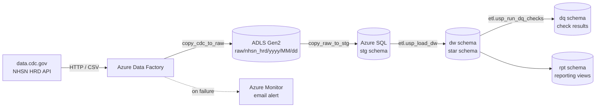
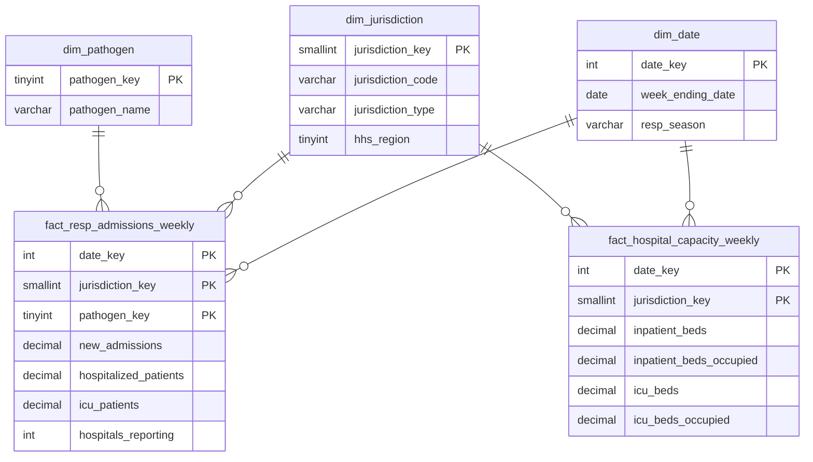

# CDC Public Health Data Warehouse

An end-to-end Azure data warehouse that ingests CDC hospital respiratory surveillance data every week, validates it, and models it into a star schema for reporting on COVID-19, influenza, and RSV hospitalizations across all U.S. states, territories, and HHS regions.

Built as a portfolio project to demonstrate database development, ETL, data quality, and security practices on the Microsoft data stack.

---

## Architecture



**Pipeline:** `pl_load_nhsn_hrd` runs every Saturday at 10:00 AM ET (after CDC's Friday release) and completes in about a minute.

| Step | Activity | What it does |
|---|---|---|
| 1 | `copy_cdc_to_raw` | Pulls the selected columns from the CDC API as CSV into a dated folder in the data lake |
| 2 | `copy_raw_to_stg` | Truncates and reloads the staging table from that file, tagging each row with its source file |
| 3 | `sp_load_dw` | Types, validates, and upserts staging data into the star schema; logs the run |
| 4 | `sp_run_dq_checks` | Runs 10 data quality checks; fails the pipeline on any Error-level failure |

---

## Tech stack

| Area | Tools |
|---|---|
| Orchestration | Azure Data Factory (Git-integrated, weekly schedule trigger) |
| Storage | Azure Data Lake Storage Gen2 (raw landing zone) |
| Database | Azure SQL Database (serverless, free offer) |
| Transformation | T-SQL stored procedures |
| Monitoring | Azure Monitor alert rule + action group (email on pipeline failure) |
| Local DBA practice | SQL Server 2022 in Docker |
| Tooling | VS Code (MSSQL extension), Azure CLI, Git/GitHub, Python |

---

## Data source

**NHSN Weekly Hospital Respiratory Data (HRD) Metrics by Jurisdiction**, published by CDC on [data.cdc.gov](https://data.cdc.gov/d/ua7e-t2fy) (dataset `ua7e-t2fy`).

- One row per jurisdiction per week, from August 2020 to present
- 67 jurisdictions: 50 states, DC, 5 territories, 10 HHS regions, and a national total
- ~250 columns in the source; this project selects 25 base measures and recalculates derived metrics
- Preliminary data is released mid-week and replaced by official data on Fridays, so values can be revised after first publication

---

## Data model



| Schema | Purpose |
|---|---|
| `stg` | Raw text exactly as received from CDC |
| `dw` | Star schema: 3 dimensions, 2 facts at different grains |
| `etl` | Load and data quality procedures, plus the `load_run` log |
| `dq` | Data quality check results history |
| `rpt` | Reporting views, exposed to a read-only role |

---

## Key design decisions

- **CSV instead of JSON from the API.** The Socrata JSON API omits fields that are null, so rows have different shapes (e.g., RSV fields are absent before RSV reporting began). CSV with an explicit `$select` always returns the same 25 columns in the same order, which keeps the copy mapping stable.
- **Raw landing zone before staging.** Every run keeps an untouched, dated copy of exactly what CDC sent. Loads can be replayed or debugged without calling the API again.
- **Text-only staging.** Staging never rejects a row. Type conversion happens in the load procedure with `TRY_CONVERT`, so bad values become NULLs that data quality checks can count and report instead of failing the copy.
- **Idempotent upserts.** The load uses `MERGE` with an `EXISTS (... EXCEPT ...)` change test, which handles NULL comparisons correctly and only updates rows CDC actually revised. Rerunning a load with unchanged data inserts and updates nothing.
- **Unpivoted pathogen dimension.** The source spreads COVID-19, flu, and RSV across separate columns. The admissions fact reshapes them into rows keyed by `dim_pathogen`, which makes cross-pathogen comparison a simple filter or group-by.
- **Two fact tables at different grains.** Bed capacity is per jurisdiction-week; admissions are per jurisdiction-week-pathogen. Keeping them separate avoids repeating capacity values three times.
- **Transactional load with run logging.** The load runs in a single transaction with `XACT_ABORT`. The run log entry is written outside the transaction, so failures are still recorded with their error message, then re-raised so Data Factory marks the run failed.
- **Derived percentages in views, not tables.** Occupancy rates and week-over-week changes are calculated in the `rpt` views so they always match the underlying counts.

---

## Data quality

`etl.usp_run_dq_checks` runs after every load and writes results to `dq.check_result`, linked to the load run and the Data Factory run ID.

| Check | Severity | Catches |
|---|---|---|
| `volume_vs_previous_load` | Error | Row count drops more than 5% from the previous load |
| `unknown_jurisdiction_codes` | Error | New codes from CDC not present in `dim_jurisdiction` |
| `incomplete_weeks` | Error | A week missing rows for some jurisdictions |
| `missing_weeks` | Error | Gaps in the weekly sequence |
| `negative_values` | Error | Negative counts in the facts |
| `duplicate_keys_in_staging` | Warning | The same week and jurisdiction delivered twice |
| `unparseable_values_in_staging` | Warning | Values that failed type conversion |
| `occupied_exceeds_capacity` | Warning | Occupied beds greater than total beds |
| `age_groups_exceed_total` | Warning | Adult + pediatric admissions greater than the total |
| `data_freshness` | Warning | Latest week older than 14 days |

Any Error-level failure raises an exception, which fails the pipeline and triggers the email alert. A live demo of this is in [`tests/demo_dq_failure.sql`](tests/demo_dq_failure.sql).

---

## Security and governance

- **No secrets anywhere.** Data Factory authenticates to storage and SQL with its system-assigned managed identity. The repo contains no passwords or keys.
- **Least privilege.** The Data Factory identity can load and truncate staging, insert DQ results, and execute procedures in `etl`. It has no direct access to the star schema; procedures write there through ownership chaining.
- **Read-only reporting role.** `rpt_reader` can select from the `rpt` views only.
- **Storage hardening.** TLS 1.2 minimum and public blob access disabled.
- **Monitoring and cost control.** Email alert on any failed pipeline run, plus a monthly budget alert on the subscription.

---

## Known data issues

The `occupied_exceeds_capacity` warning flags 48 of ~21.7K jurisdiction-weeks. Investigation showed these are reporting artifacts in the source data, not pipeline errors:

1. **Early reporting ramp-up (Aug–Oct 2020).** Hawaii and Arizona account for most flags in the first months of federal hospital reporting.
2. **Voluntary reporting period (May–Oct 2024).** Single-week anomalies in Massachusetts, Vermont, and Alabama fall inside the window when hospital reporting to NHSN was voluntary, so capacity and occupancy could come from different sets of reporting hospitals.
3. **Small jurisdictions.** Guam and the Northern Mariana Islands have few hospitals, so one facility's reporting gap swings the jurisdiction-level average.
4. **Zero-capacity reports.** Some weeks report 0 ICU beds alongside occupied ICU beds.

These remain flagged as Warnings rather than being filtered or tolerance-adjusted, so they stay visible to report consumers.

---

## Repository structure

```
cdc-health-dw/
├── adf/        Data Factory pipelines, datasets, linked services, triggers (managed by ADF Git integration)
├── analysis/   Example queries against the reporting views
├── sql/        Database setup scripts, run in numeric order
└── tests/      Demo and test scripts
```

| Script | Purpose |
|---|---|
| `001_schemas_and_permissions.sql` | Schemas and least-privilege grants for the Data Factory identity |
| `002_staging_tables.sql` | Staging table |
| `003_star_schema.sql` | Dimensions and facts |
| `004_seed_dimensions.sql` | Jurisdiction (with HHS region mapping) and pathogen reference data |
| `005_etl_load_dw.sql` | Load log and star schema load procedure |
| `006_dq_checks.sql` | Data quality results table and check procedure |
| `007_reporting_views.sql` | Reporting views and read-only role |

All scripts are idempotent and safe to re-run.

---

## Rebuilding the environment

1. Create an Azure SQL Database, an ADLS Gen2 storage account (`raw` container), and a Data Factory.
2. Run the scripts in `sql/` in order. Script `001` must run as the Microsoft Entra admin because it creates a user `FROM EXTERNAL PROVIDER`.
3. Grant the Data Factory managed identity **Storage Blob Data Contributor** on the storage account.
4. Connect the Data Factory to this repo (root folder `/adf`, collaboration branch `main`) and publish.

---

## Example questions the warehouse answers

- How are COVID-19, flu, and RSV admissions trending in a given state, week over week?
- Which states' hospitals are fullest right now, and what share of patients are respiratory cases?
- How does the current flu season compare to previous seasons in total admissions and peak week?

See [`analysis/`](analysis/) for the queries.

---

## Roadmap

- [x] Performance tuning at higher data volume (Query Store, indexing, before/after measurements)
- [ ] DBA practice on local SQL Server: backup/restore, SQL Agent job, server auditing
- [ ] Dashboard on the `rpt` views
- [x] Store the CDC app token in Azure Key Vault
- [x] Add PLACES county health estimates as a second source

---

*Data: CDC National Healthcare Safety Network, via data.cdc.gov. This is an independent portfolio project and is not affiliated with or endorsed by CDC.*
